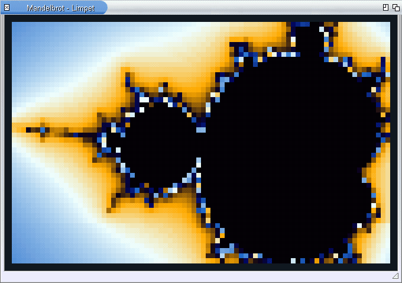
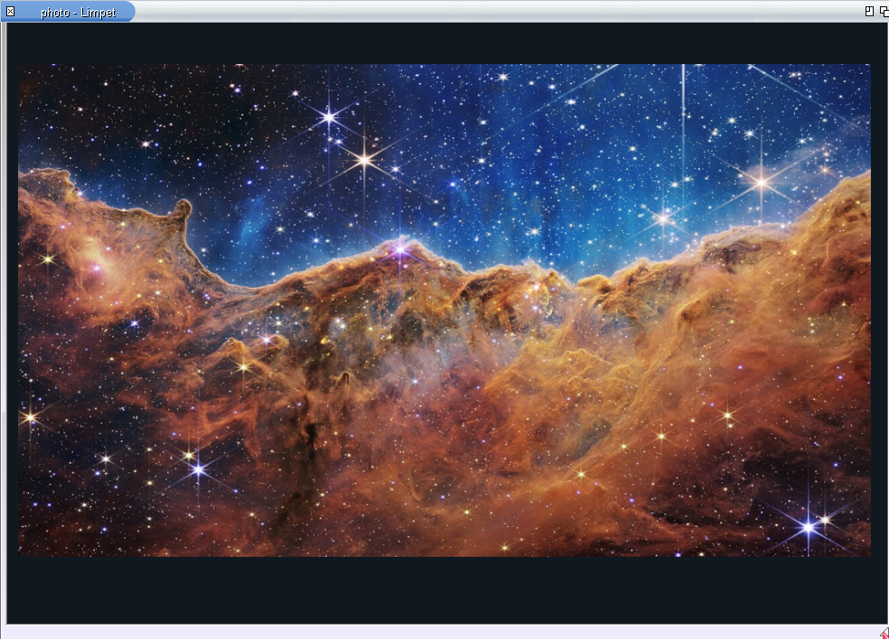

# Limpet

I wanted a modern terminal on AROS, so I started building Limpet.

It runs the AROS Shell with Unicode, scrollback, copy and paste, clickable
links and inline images. Text and history reflow when you resize the window.

The goal is to replace `CON:`: keep compatibility with existing AROS
software and support modern command-line tools, full-screen applications
and remote work over SSH.



Mandelbrot zoom, drawn with Unicode half-blocks and 24-bit ANSI colours.



Webb’s *Cosmic Cliffs*, displayed with the Kitty graphics protocol.
Image: NASA, ESA, CSA, STScI.

## Download

- [Limpet 0.7.1](https://github.com/tomaszstaniak/limpet/releases/tag/v0.7.1)
  for AROS ABIv11, x86_64 (AROS One and similar), and for mainline AROS,
  x86_64.
- A test build of 0.7.1 for AROS on the Raspberry Pi (AArch64) in the same
  release. It was run under QEMU's Pi model, not yet on a Raspberry Pi.
- [SDK 0.5.0](https://github.com/tomaszstaniak/limpet/releases/tag/sdk-v0.5.0)
  for application developers.
- The separate `LIMPET:` console handler is an experimental download in the
  0.7.1 release. It does not replace `CON:`. See [installation and limits](doc/limpet-handler.md).

Earlier releases are listed on [GitHub](https://github.com/tomaszstaniak/limpet/releases).
See the [terminal changelog](doc/changes.md) and [SDK changelog](sdk/CHANGES.md)
for version history. The `main` branch also contains unreleased development.

## Features

Use Limpet for everyday Shell work: reading long command output, copying
commands and paths, following links, and running tools such as apkg with
colours and progress updates.

| apkg in Limpet, dark theme | Inline image beside coloured text |
| --- | --- |
|  |  |

Limpet includes:

- UTF-8 text, CJK, monochrome emoji and combining characters;
- 16-colour, 256-colour and 24-bit colour, with dark, light and high-contrast
  themes; the Shell prompt keeps its Workbench pen colours;
- DejaVu Sans Mono Nerd Font, including file-type icons for tools such as eza;
- scrollback, output search and Ctrl-R command-history search;
- selection that stays while other rows change, and copy and paste through
  the system clipboard;
- text and history that reflow when the window is resized;
- file drag and drop from Workbench onto the command line;
- window titles showing the running command and, when supplied by the
  application, its current activity;
- full-screen applications, bracketed paste, resize and mouse reports,
  modified Enter and synchronized screen updates;
- Ctrl-C/D/E/F signals and Ctrl-\ end-of-input;
- inline images through a [subset of the Kitty graphics protocol](doc/kitty-graphics.md);
- Ctrl+click links: web addresses go to OpenURL, local files open through
  Workbench with their default tool;
- a [settings file](doc/search-and-settings.md) for font, size, theme,
  scrollback and command history.

[Helix](https://github.com/tomaszstaniak/aros-helix) runs in Limpet as a
native AROS editor. Terminal applications are separate downloads; they are
not included with Limpet.

The AROS Shell itself is unchanged: Limpet is the window it runs in.
Limpet runs alongside the system console for now. Programs that explicitly
open `CON:` still use the existing console handler.

[Why Limpet](doc/why-limpet.md) compares the Shell in `CON:` and in Limpet,
with the same bytes sent to both.

## Install

Each system has its own archive on the
[releases](https://github.com/tomaszstaniak/limpet/releases) page:

| System | Archive (0.7.1) | apkg |
| --- | --- | --- |
| AROS One and other ABIv11 systems, x86_64 | `Limpet-0.7.1-aros-x86_64-abiv11-pc.zip` | `apkg install limpet` |
| mainline AROS (ABIv1), x86_64 | `Limpet-0.7.1-aros-x86_64-abiv1-pc.zip` | listed in the catalogue; the [apkg build for mainline](https://github.com/tomaszstaniak/arospkg) is experimental |
| AROS on the Raspberry Pi (ABIv1, AArch64), test build | `Limpet-0.7.1-aros-aarch64-abiv1-raspi.zip` | not listed |

Releases up to 0.7.0 named the same archives `-abiv11`, `-v1-x86_64` and
`-v1-aarch64`.

By hand on AROS One:

    UnZip Limpet-0.7.1-aros-x86_64-abiv11-pc.zip -d SYS:Utilities

Mainline AROS and the Pi system do not come with UnZip. Unpack the archive
on another computer (or with an UnZip you installed) and copy the `Limpet`
drawer and `Limpet.info` into `SYS:Utilities`; for the Pi, onto its SD card.

Then double-click the Limpet icon, or run `SYS:Utilities/Limpet/Limpet`.
The archive's `README.txt` lists keys, options and known limitations.

## For programmers

Programs using standard C or DOS I/O can write text and read lines without
the SDK. Limpet decodes their UTF-8 output. The SDK is for programs that want
colour, progress lines, links or images in Limpet and plain text in `CON:`
and in files.

```c
LimpetPresentation p;
char red[LIMPET_SEQUENCE_MAX];

fflush(stdout);
if (limpet_query_presentation(Output(), &p, NULL) == LIMPET_OK &&
    limpet_sgr_ansi(red, sizeof red, &p, 1, 0))
    printf("%serror:%s file not found\n", red, LIMPET_SGR_FG_DEFAULT);
else
    printf("error: file not found\n");
```

The query uses a DOS packet on the output handle without reading keyboard
input. If the console does not support it, the application can use plain text.

| `hello` in Limpet | the same examples in `CON:` |
| --- | --- |
|  |  |

The SDK archive (`limpet-sdk-0.5.0.zip`, tag `sdk-v0.5.0`) contains the
headers, a prebuilt library for ABIv11, the library sources, eight
examples and this documentation.

- [Getting started](doc/sdk/getting-started.md): build and run the first
  example.
- [What to use, and when](doc/sdk/choosing.md): plain output, colour,
  links, images, raw keys.
- [Capability catalogue](doc/capabilities.md): supported features, detection and limits.
- [API reference](doc/sdk/api.md), [protocol reference](doc/protocols.md),
  [examples](doc/sdk/examples.md).
- [Compatibility](doc/compatibility.md),
  [troubleshooting](doc/troubleshooting.md),
  [versions and stability](doc/versioning.md).

## Build

Cross-build with the compiler and SDK for the target system. For example,
with the mainline x86_64 GCC toolchain:

```sh
make target TARGET=aros-x86_64-abiv1-pc \
    T_CC=/path/to/x86_64-aros-gcc \
    T_SDK=/path/to/AROS/Developer
```

The other targets are `aros-x86_64-abiv11-pc` and
`aros-aarch64-abiv1-raspi`. Compiler settings and required variables are in
[mk/](mk/). Output goes into `build/<target>/`.

To reproduce a release, check out its tag and use the matching compiler,
SDK, `LIMPET_VERSION` and `LIMPET_DATE`. The date is embedded in the binary.

Run the host tests with:

    make test

Building the SDK archive: [doc/sdk/releasing.md](doc/sdk/releasing.md).
Source layout and protocol notes: [doc/](doc/).
Planned ports and features: [roadmap](doc/roadmap.md).

The `main` branch may contain work that is not in a release yet. This
README and `doc/` describe the latest release unless a page says otherwise.

## In development

The following changes are on `main`, but are **not in the 0.7.1 download**:

- [Preferences and startup commands](doc/session-start.md): choose Fastfetch
  with a compact layout or an AROS image, or run your own command when a
  new Shell opens. Fastfetch is installed separately.
- SDK 0.6.0: queries for text support, terminal identity, Kitty graphics
  support and geometry in pixels.
- DEC mode 7 to control automatic line wrapping.

See the [unreleased changes](doc/changes.md#unreleased) and
[roadmap](doc/roadmap.md).

## Contributing

Bug reports and patches: [CONTRIBUTING.md](CONTRIBUTING.md).

## Why the name?

A limpet is a mollusc. It has a shell and attaches itself to a surface.
That's where the name comes from.

## Licence

MIT, see [LICENSE.txt](LICENSE.txt); the SDK is under the same licence and
contains no third-party code. Bundled components of the terminal keep
their own licences: HarfBuzz (`vendor/harfbuzz/COPYING`), utf8proc
(`vendor/utf8proc/LICENSE.md`), Unicode data
(`data/unicode-17.0/LICENSE.txt`), Unifont (SIL OFL 1.1, `assets/fonts/`),
Noto Emoji (SIL OFL 1.1, `assets/fonts/NotoEmoji-OFL.txt`) and
DejaVu Sans Mono Nerd Font (`assets/fonts/DejaVu-NerdFont-LICENSE.txt`).

Author: Tomasz Staniak, <https://tomaszstaniak.com>
