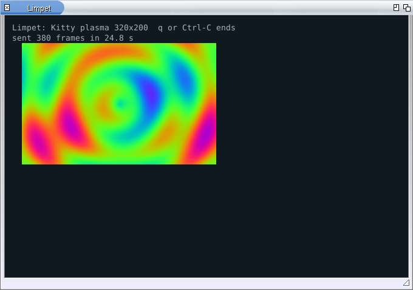
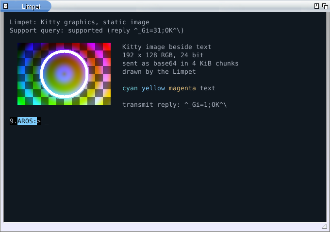

# Limpet

A terminal for the AROS Shell, written for AROS. It is not a port of X11
xterm.

Limpet opens an Intuition window and runs a real AROS Shell in it, drawn
with FreeType and HarfBuzz:

- Unicode: CJK, emoji (monochrome), combining clusters;
- 16-colour, 256-colour and 24-bit colour, themes (dark, light, high
  contrast); the Shell's own prompt keeps its Workbench pen colours;
- scrollback; selection, copy and paste through the system clipboard;
- text and scrollback rewrap when the window is resized;
- the alternate screen used by full-screen programs;
- Ctrl-C to break the running command;
- inline images through a documented subset of the Kitty graphics protocol;
- OSC 8 hyperlinks (Ctrl+click opens them through OpenURL when installed).

Version 0.1 is for **AROS ABIv11** (AROS One, 2026.09 and later, x86_64).
It does not replace the system console: programs that open `CON:`
themselves still get the system console window.

| apkg in Limpet, dark theme | Inline image beside coloured text |
| --- | --- |
|  |  |

## Install

With [apkg](https://github.com/tomaszstaniak/arospkg):

    apkg install limpet

Or by hand: download `Limpet-0.1.0-abiv11.zip` from the
[releases](https://github.com/tomaszstaniak/limpet/releases), then

    UnZip Limpet-0.1.0-abiv11.zip -d SYS:Utilities

and double-click the Limpet icon, or run `SYS:Utilities/Limpet/Limpet`.
The archive's `README.txt` lists keys, options and known limitations.

## Build

Limpet is built on a host with an AROS ABIv11 cross toolchain (GCC 10.5)
and the ABIv11 SDK:

    make abiv11-frontend LIMPET_VERSION=0.1.0 \
         ABIV11_GCC=/path/to/x86_64-aros-gcc \
         ABIV11_SDK=/path/to/SDK/Development

The result is `build/abiv11/aros-xterm` (installed as `Limpet`). Host tests
of the terminal model and protocols need only a C compiler:

    make test

Source layout and protocol notes: [doc/](doc/).

## Licence

MIT, see [LICENSE.txt](LICENSE.txt). Bundled components keep their own
licences: HarfBuzz (`vendor/harfbuzz/COPYING`), utf8proc
(`vendor/utf8proc/LICENSE.md`), Unicode data (`data/unicode-17.0/LICENSE.txt`),
Unifont (SIL OFL 1.1, `assets/fonts/`) and Noto Emoji (SIL OFL 1.1,
`assets/fonts/NotoEmoji-OFL.txt`).

Author: Tomasz Staniak, <https://tomaszstaniak.com>
