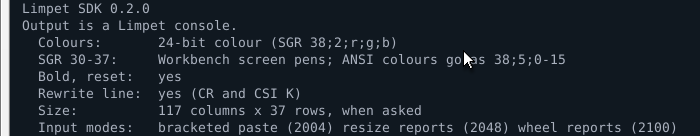
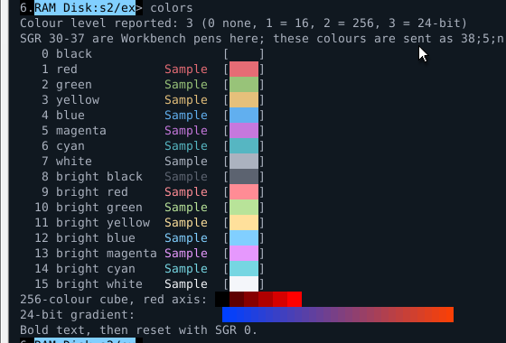
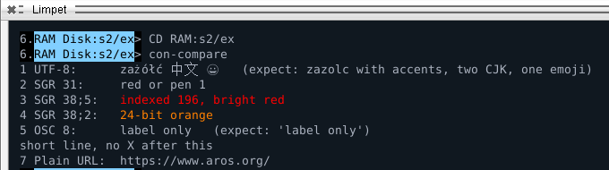
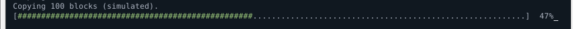
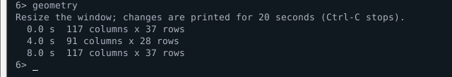
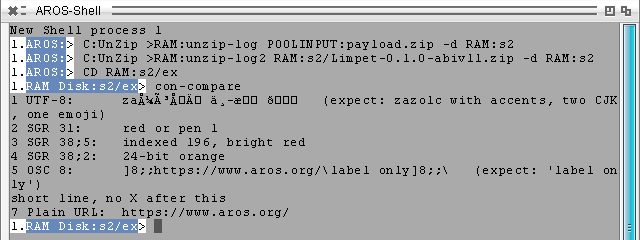
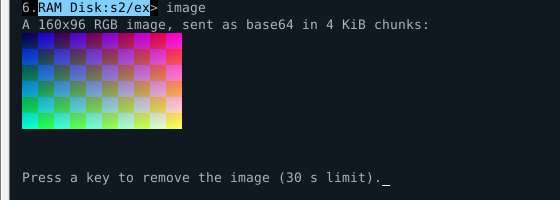

# Capability catalogue

This is the single list of what Limpet does, for users and for programmers.
Each entry says how a program finds out about it, what to send, what to do
when it is missing, and how far it has been checked.

Applies to **Limpet 0.2.0, 0.2.1 and 0.3.0** and **Limpet SDK 0.2.0 and
0.3.0** for **AROS ABIv11,
x86_64**. The Since column gives the first version with the feature. Other builds are covered in
[compatibility](compatibility.md).

## Status labels

| Label | Meaning |
| --- | --- |
| **Verified** | Checked on Limpet 0.2.0 running on AROS ABIv11 2026.09 x86_64 under QEMU, 2026-10-07. |
| **Verified (0.3.0)** | Checked on Limpet 0.3.0 (the released program, byte for byte) on AROS One 1.3 (ABIv11) x86_64 under QEMU, 2026-10-11. Not checked on ABIv11 2026.09. |
| **Verified (0.1.0)** | Checked on Limpet 0.1.0 on that system; the code behind it did not change in 0.2.0, and it was not checked again. |
| **Released, host-tested** | In a release. Its exact bytes are checked by host tests; on AROS it was checked on a development build or a different system, as stated, or not at all. |
| **Experimental** | In the source tree only, not in any public release. May change or disappear. |
| **Not supported** | Not implemented. A program must not rely on it. |

"Host tests" are the programs under `tests/` and `sdk/tests/`, run by
`make test` on a desktop computer. They prove the terminal model and the
SDK produce and accept the right bytes. They prove nothing about AROS on
their own.

## How a program finds out

There are three separate ways, and most capabilities have only one of them:

1. **The presentation query** (operation 13). A DOS packet on your output
   handle. It reports colours, bold, line rewriting, the window size, how
   SGR 30-37 are read and, from 0.2.0, which input modes a raw-mode
   program may turn on. It does not read input. This is the method to use
   first. [Details](presentation.md).
2. **Stream queries** such as `CSI 6 n` or the Kitty `a=q` query. The
   answer arrives as input, and Limpet sends it only while the console is
   in raw mode. Use them only after the presentation query has succeeded.
3. **Nothing.** Many features (Unicode, scrollback, the alternate screen)
   have no query. A successful presentation query means the console
   implements this protocol; today that is Limpet 0.1.0 or later, and this
   catalogue says what each version does.

`XTY_CAPS` (operation 1) is **not** a way to find any of this: a Limpet
Shell session does not answer it. See
[the protocol reference](protocols.md#control-operations).

## Summary

| Capability | For | How to detect | Since | Status |
| --- | --- | --- | --- | --- |
| [Presentation query](#presentation-query) | programs | itself | 0.1.0 | Verified |
| [16, 256 and 24-bit colour](#colours) | programs | query, colour level | 0.1.0 | Verified |
| [SGR 30-37 as Workbench pens](#sgr-30-37-as-workbench-pens) | programs | query, `XTY_COLOR_PENS` | 0.1.0 | Verified |
| [Bold and reset](#text-styles) | programs | query, `XTY_STYLE_BOLD_RESET` | 0.1.0 | Verified |
| [Underline, inverse](#text-styles) | programs | none | 0.1.0 | Released, host-tested |
| [Rewriting a line](#rewriting-a-line) | programs | query, CR and ERASE_EOL | 0.1.0 | Verified |
| [Window size](#window-size) | programs | query, geometry known bit | 0.1.0 | Verified |
| [Size by `CSI 18 t`](#window-size) | raw-mode programs | none | 0.1.0 | Released, host-tested |
| [Cursor movement and erasing](#cursor-movement-and-erasing) | full-screen programs | none | 0.1.0 | Released, host-tested |
| [Cursor position report](#cursor-position-report) | raw-mode programs | none | 0.1.0 | Released, host-tested |
| [Alternate screen](#alternate-screen) | full-screen programs | none | 0.1.0 | Verified |
| [Unicode text](#unicode-text) | everyone | none | 0.1.0 | Verified |
| [Hyperlinks (OSC 8)](#hyperlinks) | programs | query success | 0.1.0 | Verified (0.1.0) for display and hover; opening not verified |
| [Plain URL detection](#hyperlinks) | users | none | 0.1.0 | Released, host-tested |
| [Inline images (Kitty subset)](#inline-images) | programs | query success, then `a=q` | 0.1.0 | Verified; bottom edge and `clear` changed in 0.3.0: Verified (0.3.0) |
| [Window title (OSC 0/2)](#window-title) | programs, users | query, `XTY_FEATURE_TITLE` | **0.3.0** | Verified (0.3.0) |
| [Keyboard input, cooked and raw](#keyboard-input) | programs | none | 0.1.0 | Verified |
| [Ctrl-C](#ctrl-c) | everyone | none | 0.1.0 | Verified, with limits; one prompt after a break: Verified (0.3.0) |
| [Mouse reporting](#mouse-reporting) | raw-mode programs | none | 0.1.0 | Released, host-tested |
| [Bracketed paste (DEC 2004)](#bracketed-paste) | raw-mode programs | query, `XTY_INPUT_BRACKETED_PASTE` | **0.2.0** | Verified |
| [Resize reports (DEC 2048)](#resize-reports) | raw-mode programs | query, `XTY_INPUT_RESIZE_REPORT` | **0.2.0** | Verified |
| [Wheel reports (private mode 2100)](#wheel-reports) | raw-mode programs | query, `XTY_INPUT_WHEEL_REPORT` | **0.2.0** | Verified |
| [Input modes end with raw mode](#input-modes-end-with-raw-mode) | everyone | none | **0.2.0** | Verified |
| [Selection kept during output](#user-interface-features) | users | not visible to programs | **0.2.0** | Verified |
| [Scrollback, reflow, copy and paste](#user-interface-features) | users | not visible to programs | 0.1.0 | Verified |
| [Themes](#user-interface-features) | users | not visible to programs | 0.1.0 | Verified (0.1.0) |
| [termios, PTY, TTY control operations](#terminal-settings-termios-and-pty) | POSIX programs | `XTY_CAPS` on a PTY | | Experimental |
| [SSH client](#ssh) | users | none | | Experimental |
| Title stack (`CSI 22`/`23 t`), icon name (OSC 1), save cursor (DECSC), any-motion mouse, resize signals | | | | Not supported |

The rest of this page has one section per row.

---

## Presentation query

**What it gives you.** One answer to "what will this console render?",
without touching the keyboard or terminal modes: colour level, bold and
reset, line rewriting, current size, how SGR 30-37 are read and, from
0.2.0, the input modes a raw-mode program may turn on.

**Problem it solves.** On AROS the same program can write to `CON:`, to a
file, to a pipe or to Limpet. Escape sequences that look good in Limpet
print as garbage in `CON:` and end up in files. The query lets a program
decorate only when the decoration will be shown.

**Detect.** It is its own detection. `ERROR_ACTION_NOT_KNOWN` means the
console does not implement it.

**Use.**

```c
LimpetPresentation p;
fflush(stdout);
if (limpet_query_presentation(Output(), &p, NULL) == LIMPET_OK) {
    /* decorate according to p */
} else {
    /* plain text */
}
```

Raw protocol: operation 13 in an `XtyControl` block, sent as packet type
`XTY_ACTION_CONTROL`. Wire format in [presentation.md](presentation.md);
API in [the SDK reference](sdk/api.md).

**Rules that matter.**

- **Query the handle you write to.** Usually `Output()`. Never `Input()`:
  with `program >file` the input is still the terminal but the text goes to
  the file.
- **A clear known bit means unknown, not absent.** A set bit with a zero
  value means confirmed absent. The SDK zeroes fields whose bit is clear.
- **Ignore what you do not know.** Unknown bits and the reserved values
  8 to 11 must not make a client fall back to plain text. A newer Limpet
  may set them. (Limpet 0.2.0 started using `values[7]` this way: a 0.1.0
  client ignores it and still decodes everything else.)
- **The answer is a snapshot.** It describes the console at that moment.
  The size in particular changes when the user resizes the window.
- **It blocks** until the handler replies. Limpet and `CON:` reply at once.
  There is no timeout: DOS packets have none.
- **Non-interactive handles get no packet.** The SDK checks
  `IsInteractive()` first and returns `LIMPET_NOT_INTERACTIVE`.
- **`ERROR_ACTION_NOT_KNOWN`** comes from `CON:`, from consoles that are
  not Limpet, and from a Limpet session that is closing. All three mean
  "write plain text".

**Example.** [`hello`](../sdk/examples/hello.c).



*`hello` (SDK 0.2.0) in Limpet 0.2.0 on ABIv11 2026.09: 24-bit colour,
pens, bold, line rewriting, 117x37 cells and the three input modes.*

**Status.** Verified 2026-10-07 on AROS ABIv11 2026.09 x86_64 under QEMU:
Limpet 0.2.0 answers with all six fields known; the published Limpet 0.1.0
answers the same SDK 0.2.0 client with the first five, and `hello` reports
the input modes as unknown there; `CON:` answers `ERROR_ACTION_NOT_KNOWN`;
output redirected to a file is reported as not interactive. apkg's
presentation support was accepted against this query on AROS One 1.3
(Limpet 0.1.0). Host tests: `sdk/tests/test_sdk.c` sends the SDK's request
through Limpet's own reply code; `sdk/tests/test_sdk_compat.sh` decodes the
0.2.0 reply with the SDK 0.1.0 sources.

---

## Colours

**What it gives you.** Coloured text at one of three levels.

| Level | Value | Promised sequences (7-bit `ESC [` only, semicolon form) |
| --- | --- | --- |
| ANSI16 | 1 | SGR 30-37, 90-97, 39 (foreground); 40-47, 100-107, 49 (background) |
| INDEXED256 | 2 | adds `38;5;n` and `48;5;n` |
| RGB | 3 | adds `38;2;r;g;b` and `48;2;r;g;b` |

Limpet 0.1.0 and 0.2.0 report level 3. Colon forms (`38:2::r:g:b`) are not
promised. The 8-bit CSI byte 0x9B is not promised.

**Detect.** Presentation query: known bit `XTY_PRESENT_KNOWN_COLORS`, value
in `color_level`. Use `limpet_color_level()`, which treats a level newer
than the SDK as unknown.

**Use.** `limpet_sgr_ansi()` for the 16 colours, `limpet_sgr_rgb()` for
24-bit colour with automatic reduction to the 256-colour cube. End colours
with SGR 39/49 or SGR 0.

**Fallback.** No colour at all. Every coloured word must also make sense as
plain text: write "error:", not just red. Read the
[pens section](#sgr-30-37-as-workbench-pens) before writing SGR 30-37.

**Example.** [`colors`](../sdk/examples/colors.c).



*`colors` in Limpet, dark theme. Colour 0 is black text on a dark
background, which is why the example prints names in the default colour.*

**Status.** Verified (all three levels, `colors` example, on 0.1.0 2026-10-05 and on 0.2.0 2026-10-07).
Host tests: `tests/test_screen_model.c`, `tests/test_theme.c`.

---

## SGR 30-37 as Workbench pens

**What it gives you.** The AROS Shell prompt and other native programs
look the same in Limpet as in `CON:`, because Limpet reads SGR 30-37 and
40-47 as **Amiga screen pens 0-7**, exactly like the system console. Pen 1
is not red; it is whatever the Workbench palette says.

**Problem it solves.** Native programs written for `CON:` keep their
colours. The cost falls on programs that mean ANSI red when they write
`ESC [31m`.

**Detect.** Presentation query: `XTY_COLOR_PENS` in `interpretation`,
valid only when the known bit `XTY_PRESENT_KNOWN_INTERPRETATION` is set.
`limpet_uses_pens()` checks both.

**Use.** When pens are on, send the 16 ANSI colours as `38;5;0` to
`38;5;15` (`48;5;n` for background). These keep their ANSI meaning and are
guaranteed from colour level ANSI16 up. `limpet_sgr_ansi()` does this
choice for you.

**Reset.** SGR 39 restores the theme's default foreground and drops a
foreground pen. It does not bring back an earlier pen, and it leaves
background and bold alone (SGR 49 likewise). The next Shell prompt sets its
own pens, so a program only has to end its own colours.

**Fallback.** When the interpretation is unknown, keep normal ANSI
behaviour. When the query fails, you are not in Limpet, and SGR 30-37 in
`CON:` select pens anyway.



*Line 2 sends `ESC [31m`. Limpet shows pen 1 of the dark theme, as `CON:`
would, not red.*

**Status.** Verified 2026-10-05 and again on 0.2.0 2026-10-07 with `colors` and the comparison probe
(`tools/con_compare.c`). apkg uses this rule in its coloured output.

---

## Text styles

| Style | Sequence | Reported by the query |
| --- | --- | --- |
| Bold on, all off | SGR 1, SGR 0 | yes, `XTY_STYLE_BOLD_RESET` |
| Bold off | SGR 22 | no |
| Underline on/off | SGR 4 / 24 | no |
| Inverse on/off | SGR 7 / 27 | no |

Italic, blink, strike-through, double and curly underline are not
supported and are ignored.

**Detect.** Only bold and reset are reported. Underline and inverse have no
detection; a program that needs them must treat them as Limpet
behaviour, not a promise of the query.

**Fallback.** Do not carry meaning in a style alone.

**Status.** Bold and reset: verified. Underline and inverse:
released, host-tested (`tests/test_screen_model.c`), not checked on AROS
for this catalogue.

---

## Rewriting a line

**What it gives you.** Progress bars and status lines that update in place:
CR (byte 0x0D) returns to column 1, `CSI K` (or `CSI 0 K`) erases to the
end of the line.

**Detect.** Presentation query: `XTY_LINE_CR` and `XTY_LINE_ERASE_EOL`, both
needed. `limpet_can_rewrite_line()` checks both. CR alone would leave the
tail of a longer previous line on screen.

**Use.** `"\r" + text + "\033[K"`, flushed after each update. Keep the line
shorter than the window: ask the size before redrawing.

**Fallback.** A new line per step (10%, 20%, ...), never CR alone. Never
write CR updates to a file.

**Example.** [`progress`](../sdk/examples/progress.c).



**Status.** Verified (0.1.0: 2026-10-05; 0.2.0: 2026-10-07) (`progress`, including Ctrl-C in the
middle of the bar, return code 5). `CON:` on the same system also honours
CR and `CSI K`, but does not answer the query, so a program cannot know
that without guessing.

---

## Window size

**What it gives you.** Rows and columns of the text grid.

**Detect and use.**

- **Presentation query** (preferred): `limpet_columns()` and
  `limpet_rows()`, 0 when unknown. No input involved.
- **`CSI 18 t`** in raw mode: Limpet answers `ESC [ 8 ; rows ; cols t` on
  the input stream. Needed only by programs that already parse input
  replies.

**The size is a snapshot.** There is no resize signal. A raw-mode program
can ask for [resize reports](#resize-reports) in its input; otherwise ask
again before laying out text,
and after any long pause. Do not ask on every character: each query is a
round trip to the terminal's process.

**Limits.** At most 80 rows and 160 columns.

**Fallback.** Assume 80 columns, wrap long lines yourself, or let the
terminal wrap them.

**Example.** [`geometry`](../sdk/examples/geometry.c).



**Status.** Query: verified, including a resize during the run (0.1.0 2026-10-05, 0.2.0 2026-10-07).
`CSI 18 t`: released, host-tested (`tests/test_geometry_reply.c`), checked
in a mainline development build; not run on ABIv11.

---

## Cursor movement and erasing

**Supported.** CUP (`CSI row ; col H` / `f`), CUU/CUD/CUF/CUB
(`CSI n A/B/C/D`), CNL/CPL (`E`/`F`), CHA (`G`, `` ` ``), VPA (`d`),
ED (`CSI J`, 0/1/2), EL (`CSI K`, 0/1/2), IL/DL (`CSI L`/`M`),
SU/SD (`CSI S`/`T`), scrolling margins (`CSI top ; bottom r`), reverse
index (`ESC M`), cursor visibility (`CSI ? 25 h/l`).

**Not supported.** Save/restore cursor (`ESC 7`/`8`, `CSI s`/`u`), origin
mode, setting tab stops, insert/delete/erase character (`CSI @`, `P`,
`X`), any device attribute (DA) reply.

**Detect.** None. Use these only after the presentation query succeeded.
`CON:` implements a different, Amiga console set.

**Status.** Released, host-tested (`tests/test_screen_model.c`,
`tests/test_cursor_queries.c`, `tests/test_status_area.c`). Native
full-screen programs using positioning and the alternate screen passed the
0.1.0 release regression on ABIv11.

---

## Cursor position report

`CSI 6 n` answers `ESC [ row ; col R`; `CSI ? 6 n` answers
`ESC [ ? row ; col R`; `CSI 5 n` answers `ESC [ 0 n`. Replies come on the
input stream, **in raw mode only**; in cooked mode Limpet sends no reply,
so that nothing appears at the Shell prompt.

A program that sends a query must read the reply with a time limit
(`WaitForChar()`), parse it among ordinary key presses, and never send a
query while the user is typing something else.

**Status.** Released, host-tested (`tests/test_cursor_queries.c`); checked
on a mainline development build. The raw-mode reply channel itself was
exercised on ABIv11 by the Kitty query (2026-10-05); the `CSI 6 n` reply
was not run there.

---

## Alternate screen

`CSI ? 1049 h` switches to a separate screen without scrollback,
`CSI ? 1049 l` returns to the primary screen with its text and cursor
restored.

**Detect.** None. A full-screen program must restore the primary screen on
every exit path, including Ctrl-C.

**Status.** Verified on 0.2.0 2026-10-07 (hardcode's full screen enters and leaves it) and in the 0.1.0 release regression (native full-screen
program, resize, return to the Shell). Host test: `tests/test_alternate.c`.

---

## Unicode text

**What works.** UTF-8 output; CJK and other wide characters take two cells;
combining marks and grapheme clusters stay in one cell group; emoji are
drawn in monochrome (Noto Emoji). Width follows the bundled Unicode 17
tables, so a program that measures text with the same tables lines up.

**What does not.** Bidirectional text, colour emoji, and grapheme clusters
beyond the bounded length.

**Detect.** None. A successful presentation query means Limpet, which
decodes UTF-8. In `CON:` the same bytes show as Latin-1 characters.



*The comparison probe in `CON:` on ABIv11 2026.09: line 1 is UTF-8, shown
as Latin-1; line 5 is an OSC 8 link, printed as text.*

**Status.** Verified (0.1.0 release regression; the comparison probe on
0.1.0 2026-10-05 and on 0.2.0 2026-10-07). Host tests: `tests/test_graphemes.c`,
`tests/test_width_table.py`.

---

## Hyperlinks

**What it gives you.** Text that carries a link target. In Limpet the user
hovers to see the target in the title bar, Ctrl+clicks to open it through
OpenURL, and Ctrl+Shift+clicks to copy it.

**Use.** OSC 8: `ESC ] 8 ; ; URI ESC \` label `ESC ] 8 ; ; ESC \`. The SDK's
`limpet_osc8_open()` refuses URIs with spaces, control characters or
non-ASCII bytes, so outside text cannot inject sequences.

**Limits.** Limpet opens only `http://` and `https://` targets of at most
2047 bytes. Other schemes are shown as text and do nothing on click. 64
explicit targets are remembered per window; older ones become plain text.

**Plain URLs.** `http://` and `https://` addresses in ordinary output are
detected without any program change, also across soft line wraps.

**Fallback.** Print the URL after the label. Never send OSC 8 to `CON:`: it
prints the sequence as text (see the screenshot above, line 5).

While the pointer is over a link the title shows `Link: <target> - Limpet`;
it goes back to the window title below when the pointer leaves.

**Example.** [`hyperlink`](../sdk/examples/hyperlink.c).


**Status.** Display, underline on hover and the target in the title:
verified 2026-10-05. Opening through OpenURL: not verified on ABIv11 (it
needs an installed browser and OpenURL setup). Copying: verified on
mainline during development. Details: [hyperlinks.md](hyperlinks.md).

---

## Window title

**What it gives you.** The title bar says what runs in the window and,
when the program reports it, what that program is doing:

| Situation | Title |
| --- | --- |
| Shell waiting at its prompt | `Shell - Limpet` |
| a command runs | `Wait - Limpet` (the command's name, without its path) |
| the program set a title | `title demo: receiving - Limpet` |
| pointer over a link | `Link: https://... - Limpet` |
| the session ended | `Limpet` |

Terminal messages come after the name (`Shell - Limpet | Copied`), so a
narrow title bar cuts the message, not the name. Messages that report
something done disappear after about four seconds; those that ask for an
action (a multi-line paste waiting for F3) stay. Key hints are in the About
window, not in the title.

**What Limpet reads itself.** The Shell runs each command in its own
process and, while it runs, sets the CLI's module and its task name to the
command. Limpet reads that from the process reading the console, under the
same protection it uses for Ctrl-C. Not identified: jobs started with `Run`,
processes a command starts, and what a program is doing.

**What a program sends.** `ESC ] 2 ; text ESC \` (or BEL instead of `ESC \`;
OSC 0 works the same). The text must be 1 to 255 bytes of valid UTF-8 with
no control characters (C0, DEL, C1); otherwise the whole sequence is
ignored. An empty text drops the program's title. The title lasts while the
command that sent it runs: it goes when that command ends, another command
starts, the session ends, or a new title replaces it. A program does not
need to reset it on exit.

**Detect.** Send it only when the presentation reply has
`XTY_PRESENT_KNOWN_FEATURES` with `XTY_FEATURE_TITLE` (SDK:
`limpet_can_set_title()`). Limpet 0.2.x answers the query without that bit
and ignores the sequence; `CON:` prints it as text.

**Use.**

```c
char seq[LIMPET_TITLE_MAX + 8];
size_t n = limpet_osc_title(seq, sizeof seq, &p, "Build: linking");
if (n) limpet_write_dos((void *)Output(), seq, n);
```

Send a title when your state changes, never with each line or token:
Limpet applies at most about four title changes a second and shows the
latest.

**Limits.** The title bar uses Latin-1: characters outside it show as `?`.
No title stack (`CSI 22 t` / `CSI 23 t`), no icon name (OSC 1), no title
query. A title sent by a `Run` job ends when the next command starts.

**Example.** [`title`](../sdk/examples/title.c).

**Status.** Verified (0.3.0), 2026-10-11, AROS One 1.3: `Shell`,
`Wait` during `Wait 10` and back, an unknown command, Ctrl-C, the `title`
example's states and the return to `Shell` after it, a link hover, the end
of the session; a development branch of hardcode built with SDK 0.3.0
(`limpet-title`, not in a hardcode release) showing ready, waiting for
the model and replying, and `Shell` again after `/quit`; Limpet 0.2.1 and
`CON:` running the same hardcode showed no sequence. Host tests:
`tests/test_osc_title.c`, `tests/test_window_title.c`,
`sdk/tests/test_sdk.c`.

---

## Inline images

**What it gives you.** Pictures between lines of text, sent through the
terminal stream with a subset of the
[Kitty graphics protocol](https://sw.kovidgoyal.net/kitty/graphics-protocol/).

**Supported.** Raw RGB (`f=24`) and RGBA (`f=32`, blended over the text);
direct base64 transmission in chunks; transmit, display, delete and query;
image ids; `C=0`/`C=1`; reply control `q=0/1/2`. Full table:
[kitty-graphics.md](kitty-graphics.md).

**Not supported.** PNG, compression, files, shared memory, animation,
placement ids, scaling and cropping keys, Unicode placeholders.

**Limits.** 1024x1024 pixels and 4 MiB per image, 16 images, 16 MiB in
total.

**Detect.** Two steps:

1. The presentation query must succeed. Never send image data otherwise:
   `CON:` prints it as text.
2. Send `a=q` in raw mode and read the reply with a time limit:
   `limpet_kitty_query()` and `limpet_kitty_parse_reply()`.

**Things to know before drawing.**

- With `C=0` (the default) Limpet 0.3.0 makes room: when the image would
  pass the bottom of the window the text scrolls up first, so the whole
  image shows, and the cursor ends on its last row, one column past it.
  Limpet 0.1.0 to 0.2.1 do not scroll: the image is cut off and `C=0`
  moves the cursor no further than the last row. For every version, print
  blank lines first, move back up, draw with `C=1`, then move down; the
  [`image`](../sdk/examples/image.c) example shows how. `C=1` never moves
  the cursor or scrolls.
- `ESC [ 2 J` (clear) removes the images on the screen shown, and
  entering the alternate screen removes that screen's images (0.3.0). The
  images stay transmitted: `a=p` shows one again.
- The cell size in pixels is not reported. Reserve rows for a cell height
  smaller than the real one; the cost is a blank line or two.
- In cooked mode no reply is delivered. Use `q=2` unless you read replies.
- Delete images you no longer need (`limpet_kitty_delete(id, 1, ...)`);
  they count against the 16-image limit.
- Images are hidden while the user scrolls back and follow text only
  approximately after a width change.



**Status.** Verified (0.1.0: 2026-10-05; 0.2.0: 2026-10-07) (`image`: query reply in raw mode,
transmission, deletion). Host tests: `tests/test_kitty_graphics.c` and the
Kitty part of `sdk/tests/test_sdk.c`.

---

## Keyboard input

**Cooked mode** (the default). Limpet edits the line itself (see line
editing in the [user-interface table](#user-interface-features)). The
program receives the finished line on Enter.

**Raw mode.** `SetMode(Input(), 1)`. The program receives every key as it
is pressed. Cursor keys arrive as `ESC [ A` to `ESC [ D`. In `CON:` they
arrive as the 8-bit CSI byte 0x9B followed by the letter. A program that
supports both consoles must decode both forms. Return to cooked mode with
`SetMode(Input(), 0)` on every exit path.

`WaitForChar()` and `Read()` behave as in `CON:`.

**Example.** [`keys`](../sdk/examples/keys.c), which runs unchanged in both
consoles.

**Status.** Verified in Limpet 0.1.0 and 0.2.0 and in `CON:` (arrows, a letter,
Esc, Ctrl-C, cooked mode afterwards).

---

## Ctrl-C

- **Cooked mode:** Ctrl-C sends the break signal (`SIGBREAKF_CTRL_C`) to
  the Shell and the command it runs, as in `CON:`. Programs check it with
  `SetSignal()` or `CheckSignal()`.
- **Raw mode:** Ctrl-C arrives as byte 3. No signal is sent.

After a break the Shell shows one new prompt (0.3.0; earlier versions
printed two on one line after interrupting a running command). Ctrl-C at
an empty prompt shows `^C` and a new prompt.

**Limits.** The break does not reach jobs started with `Run`. On a
multi-processor system one press can be skipped; press again. A program
that never checks for the signal cannot be stopped this way, as in `CON:`.

**Status.** Verified (0.1.0 release acceptance; `progress` on 0.1.0,
2026-10-05: break at 33%, return code 5; `Wait 30` on 0.2.0, 2026-10-07:
return code 5).

---

## Mouse reporting

`CSI ? 1000 h` (buttons), `CSI ? 1002 h` (motion while a button is held),
`CSI ? 1006 h` (SGR encoding). Reports are generated in raw mode only.
Shift+drag still selects text. Any-motion (1003), focus events and pixel
coordinates are not supported.

**Status.** Released, host-tested (`tests/test_mouse.c`,
`tests/test_mouse_release.c`); used by a Ratatui program on a mainline
development build. Not checked on ABIv11.

## Bracketed paste

**What it gives you.** A raw-mode program sees a paste as one marked block,
not as typing, and decides itself what a newline in it means: a coding
agent keeps a pasted 50-line file as text instead of sending it line by
line.

**Use.** After `SetMode(Input(), 1)`, send `CSI ? 2004 h`. A paste then
arrives as `CSI 200 ~`, the text, `CSI 201 ~`, and Limpet does not ask for
its multi-line confirmation. Send `CSI ? 2004 l` before leaving raw mode.

**Guarantees.**

- The text never contains ESC or C1 controls: Limpet refuses such a
  clipboard whole, so a paste cannot end its own frame.
- Nothing is inserted between the markers: key presses, mouse and wheel
  reports, query replies and resize reports wait until `CSI 201 ~` has
  been delivered, however slowly the program reads.
- A paste cancelled with Esc still ends with `CSI 201 ~`.
- A new paste waits until the previous one has been delivered completely.
- If the program leaves raw mode during a paste, the rest of it is
  dropped; it never reaches the Shell unconfirmed.

**Detect.** `XTY_INPUT_BRACKETED_PASTE` in `LimpetPresentation.input`, valid
with known bit 32 (`XTY_PRESENT_KNOWN_INPUT`). Limpet 0.1.0 reports
neither; it ignores `CSI ? 2004 h` and pastes unframed, with the
confirmation.

**Status.** Verified 2026-10-07: a 20 000-byte paste arrived as one framed
block with no other byte inside it, while the window was resized during
the paste (the resize reports followed the end marker); hardcode received
a 50-line paste whole (1682 bytes, 51 lines) without confirmation.
Cancellation with Esc during delivery, a second paste during the first and
an owner change are host-tested only (`tests/test_input_order.c`, which
reads in pieces down to one byte; `tests/test_paste.c`,
`tests/test_bracketed_paste.c`).

## Resize reports

**What it gives you.** A full-screen program learns about every size change
in its input, instead of asking on a timer.

**Use.** In raw mode, send `CSI ? 2048 h`. The program receives
`CSI 48 ; rows ; columns ; height ; width t` (text area height and width in
pixels) at once, and again after every size change. If the size changes
while a report is half delivered, one more report with the newest size
follows. No report is ever cut by other input or put inside a bracketed
paste. `CSI ? 2048 l` turns it off.

**Detect.** `XTY_INPUT_RESIZE_REPORT` in `LimpetPresentation.input` (known
bit 32). With Limpet 0.1.0, use the presentation query or `CSI 18 t`.

**Status.** Verified 2026-10-07 (the first report on `CSI ? 2048 h`, two
reports after two resizes, the newest size last; hardcode redrew at each
size). Host tests: `tests/test_resize_report.c`, `tests/test_input_order.c`.

## Wheel reports

**What it gives you.** A full-screen program can scroll its own content with
the mouse wheel while text selection stays with the terminal. Ordinary
mouse tracking (1000/1002) would take the buttons as well, and the user
could no longer select and copy.

**Use.** In raw mode, send `CSI ? 2100 h`. Each wheel step arrives as an SGR
mouse report, `CSI < 64 ; column ; row M` for up and `CSI < 65 ; column ;
row M` for down, plus 16 for Ctrl and 8 for Alt. Buttons and drags are not
reported. Shift with the wheel still scrolls Limpet's own history. If
mouse tracking 1000 or 1002 is also on, it takes precedence and the wheel
is reported as part of it. `CSI ? 2100 l` turns it off.

**Why a private number.** No existing mode has this meaning. xterm's 1007
turns the wheel into cursor keys, which a program cannot tell from real
ones and which carry no position. Contour's 2029 ("passive mouse
tracking") reports every mouse event. 2100 is not used by xterm, foot,
Ghostty, Kitty, Windows Terminal, Alacritty, Contour or mintty, according
to their sources and documentation checked on 2026-10-07. It is a Limpet
extension; other terminals ignore it.

**Detect.** `XTY_INPUT_WHEEL_REPORT` in `LimpetPresentation.input` (known
bit 32). Never send `CSI ? 2100 h` without it.

**Status.** Verified 2026-10-07 (reports with the right direction and
position; none after the mode was reset; hardcode scrolled with the
wheel, and in the same session a drag selected text). Host test: `tests/test_mouse.c`.

## Input modes end with raw mode

When a Limpet Shell window returns to cooked mode (a program calls
`SetMode(Input(), 0)` or ends), Limpet turns off mouse tracking 1000, 1002
and 1006, bracketed paste 2004, resize reports 2048 and wheel reports
2100. A program that crashes or forgets to clean up therefore cannot leave
the Shell, or the next program, with modes it never asked for.

**Consequence for programs.** Set these modes after every switch to raw
mode, not once at start-up.

**Status.** New in 0.2.0. Verified 2026-10-07: after a program that left
2004, 2048 and 2100 on, the next raw-mode program received an unframed
paste after the confirmation, no resize report and no wheel report, and a
paste in the Shell asked for confirmation again. Host test:
`tests/test_bracketed_paste.c`. Limpet 0.1.0 does not reset mouse tracking
on return to cooked mode; it has no 2004, 2048 or 2100.

---

## User-interface features

These help the person at the keyboard. Programs cannot detect or control
them, and should not need to.

| Feature | Detail | Since | Status |
| --- | --- | --- | --- |
| Scrollback | 256 lines at full width (160 columns), more for narrower windows, e.g. 512 at 80 columns | 0.1.0 | Verified |
| Reflow | text and scrollback rewrap when the width changes | 0.1.0 | Verified |
| Erased rows stay separate | a row erased whole (`CSI 2 K`, or `CSI K` at column 1) no longer joins the row above when the width changes later | **0.2.0** | Verified (hardcode panel, no joined lines in the history); host-tested in `tests/test_reflow.c` |
| Selection and clipboard | drag to select, RAmiga+C / RAmiga+V, system clipboard | 0.1.0 | Verified |
| Selection kept during output | a selection stays while a program redraws other rows (a status line, a clock, a reply streaming below it), also during a drag, including selections larger than 1 KB; output that changes or scrolls the selected text clears it | **0.2.0** | Verified (selection kept while hardcode streamed a reply; copy afterwards); host-tested in `tests/test_selection.c` |
| Themes | dark (built in), light, high contrast | 0.1.0 | Verified (0.1.0) |
| Line editing | command history, Tab completion of paths and commands | 0.1.0 | Released, host-tested (`tests/test_line_editor.c`, `tests/test_completion.c`) |
| History search | Ctrl-R searches the last 32 commands ([how](#history-search)) | **0.3.0** | Verified (0.3.0); host-tested in `tests/test_line_editor.c` |
| Window title | what runs and what it reports ([above](#window-title)) | **0.3.0** | Verified (0.3.0) |
| End of input | F5 ends the Shell's input; F4 starts a new Shell | 0.1.0 | Verified (0.1.0) |

### History search

At the Shell prompt, Ctrl-R searches the commands typed in this window
(the last 32), not the output:

- type to narrow the search; Backspace removes a character;
- Ctrl-R again: the next older command that matches and reads differently;
- Enter puts the command on the line for editing; it does not run it;
- Esc puts back what was on the line before, cursor included;
- arrows, Home, End, Delete and Tab take the command and then do their job.

The line shows `(reverse-i-search)` and the query; when nothing matches it
shows `(failed reverse-i-search)` and the line stays as it was. Matching
ignores case for ASCII letters. A program in raw mode receives Ctrl-R as
byte 0x12, as before.

The erased-row change affects only programs that erase a continuation row
from column 1 and then write there: after a later width change that line
shows as two lines in the history. Limpet's own command-line editing does
not write erase sequences into the screen and is not affected.

---

## Terminal settings (termios) and PTY

The source tree contains a pseudo-terminal, a DOS packet protocol for
terminal settings (control operations 1 to 12, cancellation and immediate
I/O) and an experimental termios layer for POSIX programs. They run only in
a **mainline** preview build that is not published, together with an
experimental `posixc.library`.

A Limpet Shell session (0.1.0 and 0.2.0) answers every one of those operations with
`ERROR_ACTION_NOT_KNOWN`. Do not build on them yet. What exists is
described in [the experimental guide](sdk/experimental.md).

**Status.** Experimental.

---

## SSH

An SSH client preview exists for mainline AROS (`examples/ssh/`). It is not
part of the ABIv11 release and has not been built for ABIv11.

**Status.** Experimental.
