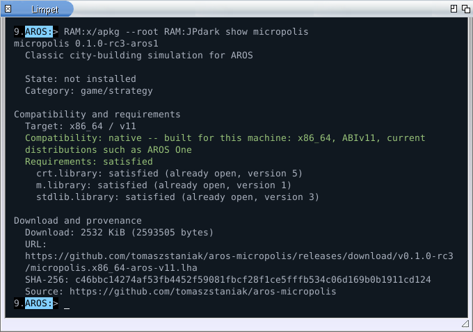
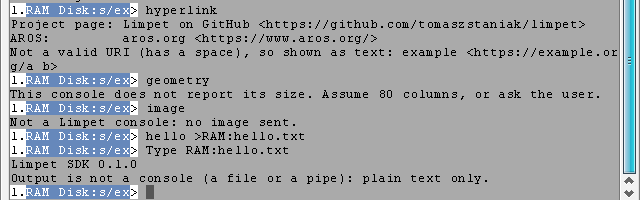
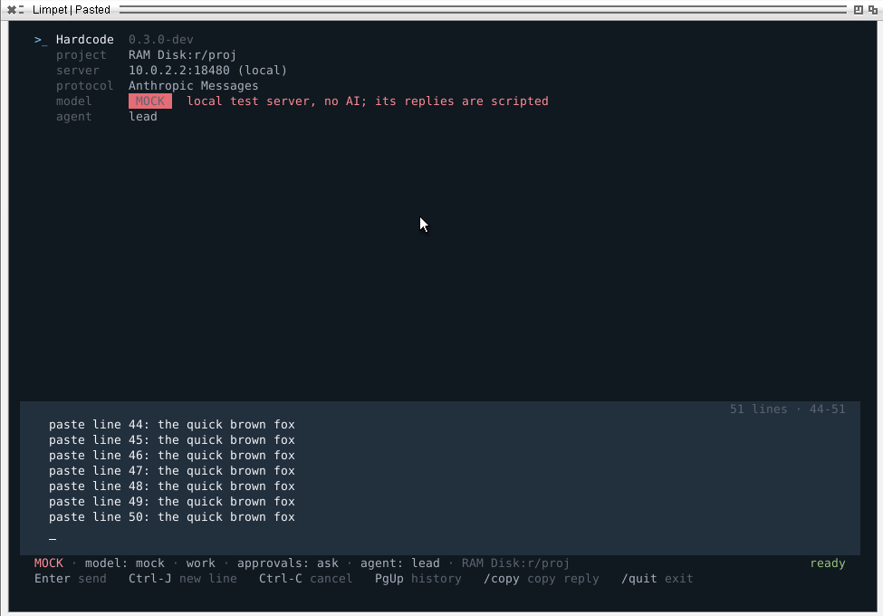
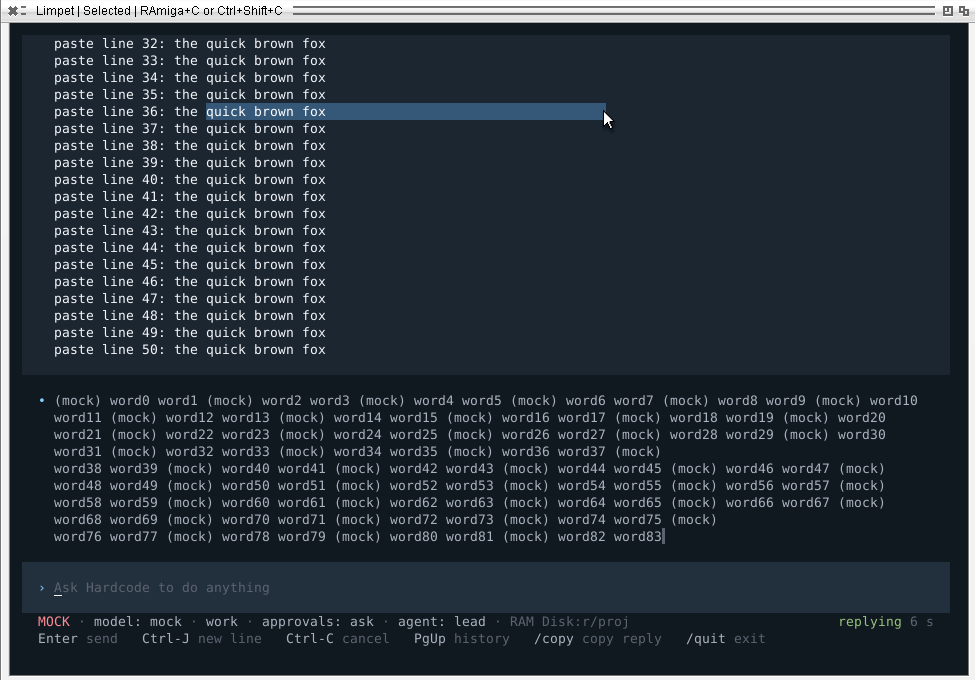

# Why Limpet

## A console for the AROS Shell

Limpet runs the native AROS Shell in an Intuition window. Commands, scripts,
assigns and prompt syntax remain unchanged. Limpet handles text rendering,
keyboard input, history and the clipboard.

The system console `CON:` remains available. Applications that open it
explicitly still get a `CON:` window. The separate experimental `LIMPET:`
handler lets applications request a Limpet window through DOS.

## Shell features

- **UTF-8:** Latin, Greek, Cyrillic, CJK, combining characters and monochrome
  emoji. Bidirectional layout is not supported.
- **Scrollback and search:** output rewraps on resize; Find searches the
  screen and history. Ctrl-R searches previously entered commands.
- **Clipboard:** mouse selection, RAmiga+C to copy and RAmiga+V to paste.
  Updates elsewhere on screen leave selected text intact.
- **Links:** hover to see the URL, Ctrl+click to open it through OpenURL,
  or Ctrl+Shift+click to copy it. OSC 8 allows a label to link to a URL.
- **Colours:** 16, 256 and 24-bit colour, with Workbench pens preserved for
  native Shell output.
- **Images:** inline RGB/RGBA through the supported Kitty graphics subset.
- **File drop:** dragging Workbench icons inserts quoted paths at the cursor.
- **Preferences:** font, size, theme and history limits in a settings file.

See [search and settings](search-and-settings.md) and the
[capability reference](capabilities.md) for controls and limits.

## Application interfaces

The presentation query reports colours, styles, line controls, dimensions
and supported input modes through a DOS packet on the output handle. It
does not read keyboard input or change terminal modes. Applications can
select formatting from the reply and use plain text when the query is unsupported
or output is redirected.

This is what apkg, the AROS package manager, does. In Limpet it shows
coloured verdicts, a table sized to the window and a single-line download
bar. In `CON:` and in redirected output it prints the same information as
plain text.

| apkg in Limpet | SDK examples in `CON:` |
| --- | --- |
|  |  |

*Left: apkg in Limpet 0.1.0. Right: the SDK examples in `CON:` on the same
system print complete plain text.*

Raw-mode applications can enable bracketed paste, resize reports and wheel
reports without taking over mouse selection. Limpet resets these modes
when the console returns to cooked mode.

hardcode, an AI coding agent for AROS, uses all three: a 50-line paste
lands in its input box as text, its panel redraws at every width, and a
selection survives while the reply streams in.

| A 50-line paste in hardcode's input box | Selection kept while a reply streams |
| --- | --- |
|  |  |

*hardcode 0.3.0-dev in Limpet 0.2.0 on AROS ABIv11 2026.09 under QEMU,
against a local test server (no AI model), 2026-10-07.*

Output uses ANSI/VT sequences, OSC 8 links and a subset of Kitty graphics.
The detection packet, Workbench pen interpretation and wheel mode 2100
are specific to Limpet. Programs using other terminal features may need
additional adaptation.

## AROS integration

Limpet integrates with native AROS facilities:

- it runs the **native AROS Shell** in an Intuition window;
- it keeps **AROS console conventions**: Workbench pens for SGR 30-37,
  Ctrl-C as the break signal, `WaitForChar()` and raw mode as programs
  expect, and from 0.2.0 it ties input modes to raw mode, which ends them
  when the program hands the console back;
- it uses **AROS services**: the system clipboard, OpenURL, FreeType and
  the system fonts;
- it reports **capabilities through a DOS packet**, without placing
  replies in keyboard input.

The standard protocols themselves (VT sequences, OSC 8, Kitty graphics) are
not Limpet's invention, and Limpet implements documented subsets of them.

## Side by side

The same test program, sending the same bytes without asking first, in
both consoles. System console: `CON:` of AROS ABIv11 2026.09 x86_64,
Limpet 0.1.0 on the same system, both under QEMU, 2026-10-05.

| Bytes sent | `CON:` | Limpet 0.1.0 |
| --- | --- | --- |
| UTF-8 text with Polish letters, CJK and an emoji | shown as Latin-1 characters | shown correctly |
| `ESC[31m` | pen 1 | pen 1 (same as `CON:`) |
| `ESC[38;5;196m` (256 colours) | ignored, default colour | bright red |
| `ESC[38;2;255;128;0m` (24-bit) | ignored, default colour | orange |
| OSC 8 link | sequence printed as text | label shown as a link |
| CR, then `ESC[K` | line rewritten | line rewritten |
| presentation query (DOS packet) | `ERROR_ACTION_NOT_KNOWN` | colour level, pens, size |
| cursor keys in raw mode | `0x9B A` (8-bit CSI) | `ESC [ A` |

| `CON:` | Limpet |
| --- | --- |
|  |  |

The comparison applies to these sequences on the named system; it is not
a complete compatibility table.

## Limits

- It is for AROS ABIv11 x86_64 only. Mainline and other architectures are
  on the roadmap, not released.
- It does not replace `CON:` system-wide.
- POSIX programs that need termios (most Unix TUI programs) do not run in
  it yet.
- There is no resize signal. Raw-mode programs can get resize reports
  (0.2.0); others ask for the size again.
- Images are raw RGB/RGBA only, without PNG or scaling.

See the [capability reference](capabilities.md) for supported interfaces and limits.
